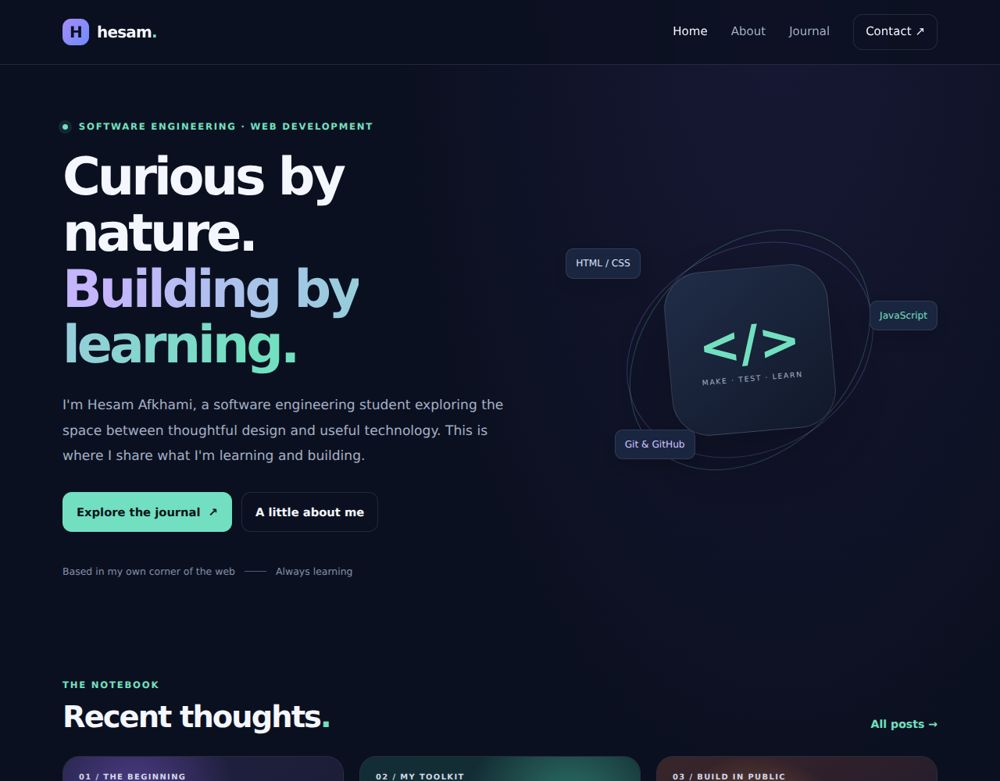

# Hesam — Personal Portfolio & Journal

A responsive static personal portfolio with a searchable journal, two articles, a project introduction and email contact.



## Run locally

Requires Python 3 and Node.js for checks. From this repository directory:

```bash
python -m http.server 8000
```

For static sites, open http://localhost:8000. Vite prints its own local address. No hosting account is required.

## Source layout

`index.html`, `about.html`, `blog.html`, `contact.html`, `post1.html` and `post2.html` are the pages. `style.css` and `main.js` are shared assets. Article links resolve directly to the committed page paths.

## Behavior and scope

There is no CMS or server-side form. Contact links open an email client. The layout uses externally hosted fonts and falls back to system fonts.

## Checks

```bash
python scripts/check_project.py
```

See [validation results](docs/VALIDATION.md) and [review changes](docs/CHANGES.md). Automated checks live in `.github/workflows/`.

## Project history

Existing commits and source history have been retained. This maintenance pass does not add a repository-wide license grant; existing notices remain applicable.
